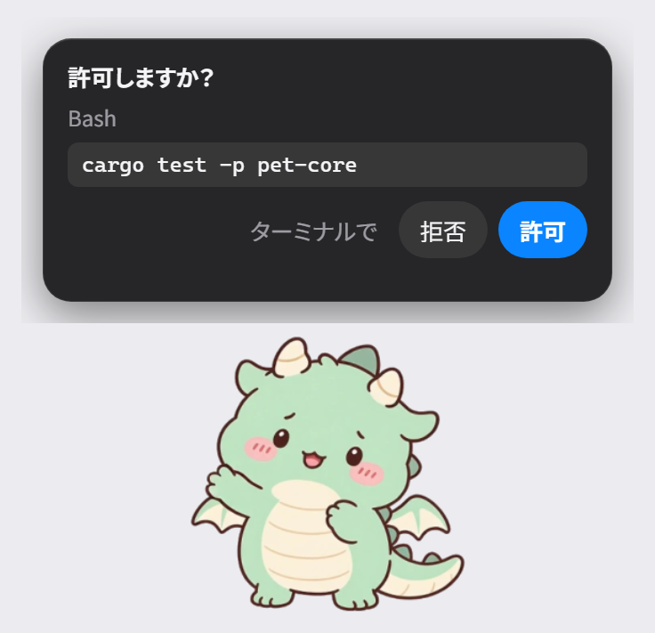

# pet-claude

Claude Code の作業に合わせて動く、Windows 用のデスクトップペット。承認や質問を吹き出しで受け、チャットと声でも話せる。ChatGPT デスクトップのペット機能を Claude Code 向けに作り直したもの。



## できること

- Claude Code の状態（作業中・入力待ち・完了・失敗）に合わせてポーズが変わる。完了・失敗・入力待ちは吹き出しの短い文と声で知らせる
- 承認待ち（`PermissionRequest`）と質問（`AskUserQuestion`）を吹き出しのカードに出し、ペットから「許可」「拒否」や選択肢を返せる。デスクトップアプリと CLI のどちらから来た要求でも動く
- チャット: ペットの下のバーから、Claude Code の対話と同じ環境（設定・CLAUDE.md・スキル・MCP）の新しいセッションに送り、答えを吹き出しと声で返す。モデル・エフォート・権限モードはチャット欄で切り替えられる
- 音声入力（ローカルの文字起こし）と読み上げ（AivisSpeech）。マイクのボタンを押して話すと、そのままチャットに送る
- ペットは 6 体（まめドラゴン・りんりん・とらちゃん・しばちゃん・こむぎちゃん・ごまちゃん）から選ぶ。フォルダを足せば増やせる
- 他のウィンドウの上に浮かび、フォーカスを奪わない。キャラクターの不透明な部分だけがクリックに反応し、ドラッグで動かせる。サインインしたら自動で出す設定もある

## 使い方

起動・操作・設定・困ったときの手順は [docs/usage.md](docs/usage.md)。画像つきの PDF マニュアルは [docs/manual/pet-claude-manual.pdf](docs/manual/pet-claude-manual.pdf)。

## 技術の詳細

ビルドには Rust（rustup）と VS 2022 の C++ ツールが要る。

```bash
cargo build --workspace --all-targets
./target/debug/pet-app.exe
./target/debug/pet-app.exe --install-hooks   # Claude Code の hooks を ~/.claude/settings.json に登録
```

- Rust のワークスペース。ペット本体は Win32 の layered window（透明な画素のクリックは OS が背後へ通す）、トレイとバー・メニュー・チャット・設定・吹き出しの UI は Tauri 2（WebView2）。1 プロセスでトレイ常駐し、UI の WebView は使うときだけ作る
- Claude Code hooks → `pet-hook.exe` → loopback HTTP（token 付き）→ アプリ。hook はどんな失敗でも exit 0 で、アプリが居なくても Claude Code を止めない。答えが無いときは Claude Code のいつもの流れに戻す
- チャットは送信ごとに `claude -p` を子プロセスで起こす。認証はサブスク（Claude Code のログイン）か API キー（Windows の資格情報マネージャー）
- 読み上げは AivisSpeech（`127.0.0.1:10101`・天深シノ）。音声入力は faster-whisper small を子プロセスで起こす
- 設定・選んだペット・位置は `%LOCALAPPDATA%\pet-claude\state.json`、ログは `%LOCALAPPDATA%\pet-claude\logs\pet.log`
- ペットの絵は Codex ペット互換のスプライトシート（8 列、行ごとに 1 ポーズ）＋姿勢の間をつなぐ動画クリップ。読み込んだらすぐ表示に要る解像度まで縮めて持つ。常駐の専有メモリ（子孫プロセス込み）は、既定の大きさのまめドラゴンで UI を出していない間 約 15MB（2026-10-28 実測・200% の画面）。ペットと大きさで増え、目安は 50MB 以内（[docs/product-requirements.md](docs/product-requirements.md) N1）

| クレート | 役割 |
|---|---|
| `crates/pet-core` | OS に触らない中心ロジック（行動の状態機械・スプライト規約・配置・hook の解析・チャットと声の規則・IPC） |
| `crates/pet-app` | アプリ本体（ペットの窓・トレイ・UI・hooks の受け口・チャット・声・自動起動） |
| `crates/pet-hook` | Claude Code の hook から起動される小さな exe |

`ui/` が UI の HTML、`assets/pets/` がペットの素材、`scripts/verify/` が実機確認のスクリプト。配布 zip は `pwsh scripts/release.ps1`（同梱物を集めて zip にし、展開し直して自己検査）。初回セットアップは zip の `SETUP.md`（Claude Code に読ませて実行する形。正本 `docs/release/SETUP.md`）。品質ゲートは `scripts/gate.sh`（`cargo fmt --check` → `cargo clippy -D warnings` → `cargo test`）。

計画: [docs/roadmap.md](docs/roadmap.md)。要件: [docs/product-requirements.md](docs/product-requirements.md)。設計: [docs/architecture.md](docs/architecture.md)。UI の見た目: [DESIGN.md](DESIGN.md)。参考にした OSS の解析: [OpenPets](docs/openpets-analysis.md)、[embed-pet](docs/embed-pet-analysis.md)

## ライセンス

MIT（[LICENSE](LICENSE)）
